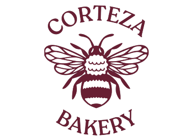

<p align="center">
  
</p>

<h1 align="center">Corteza</h1>
<p align="center"><b>Sistema de Gestión Interna para Repostería</b></p>

---

## Descripción

Los encargados de producción en reposterías pequeñas no tienen visibilidad en tiempo real de cuánto insumo tienen, cuánto necesitan para un lote y cuándo deben reponer, lo que genera producción detenida por falta de insumos o compras innecesarias por exceso de stock.

**Corteza** centraliza inventario de insumos, recetas de producción y proveedores en un solo lugar, descontando automáticamente el stock cuando se completa un lote y alertando cuando un insumo baja del mínimo.

- **Usuario final:** encargado de inventario, jefe/panadero de producción, encargado de compras.
- **Utilidad:** reduce tiempo de control manual de inventario, disminuye mermas por insumos vencidos o mal calculados, y evita compras urgentes de última hora.

## Equipo

| Integrante | Rol |
|---|---|
| Jeisson Arboleda | Product Owner |
| Jesus Nuncira | Desarrollador Backend |
| Juan Lugo | Diseñador UI/UX |
| Sebastian Quintero | QA |
| Miguel Moreno | Desarrollador Frontend + Jira/GitHub |

## Arquitectura del sistema

Corteza se organiza en 3 épicas:

- **Gestión de Inventario** — registro de stock, alertas de reposición, historial de movimientos.
- **Gestión de Producción** — recetas, planificación de lotes, descuento automático de insumos.
- **Gestión de Proveedores y Compras** — registro de proveedores, órdenes de compra, recepción de pedidos.

## Requisitos no funcionales

| Categoría | Requisito |
|---|---|
| Rendimiento | Consultas de inventario en menos de 2 segundos |
| Seguridad | Autenticación y autorización por rol; contraseñas cifradas |
| Escalabilidad | El modelo de datos soporta crecimiento sin rediseño |
| Usabilidad | Interfaz clara para personal sin perfil técnico |
| Portabilidad | Accesible desde navegador, sin instalación local |
| Mantenibilidad | Código modular, documentado, trazable a commits vía Jira-GitHub |

## Tecnologías

| Categoría | Tecnología |
|---|---|
| Backend | .NET 10 / C# · EF Core 10 ([corteza-bakery-back](https://github.com/09Miguel07/corteza-bakery-back)) |
| Frontend | Angular 22 (zoneless, signals, Signal Forms) |
| Pruebas | Vitest (front) · xUnit, Moq, Reqnroll (back) |
| Base de datos | SQL Server |
| Control de versiones | GitHub |
| Despliegue | Azure |
| Gestión de proyecto | Jira |
| IDE | Visual Studio |

## Identidad visual

| Color | Uso | Hex |
|---|---|---|
| 🟥 Rojo Corteza | Primario (logo, tipografía) | `#681F33` |
| ⬜ Crema | Fondo | `#F5EDE4` |
| 🟨 Dorado tostado | Acentos y alertas | `#C9A227` |

## Front-end (este repositorio)

SPA de Corteza para Panadería La Espiga. **Angular 22, zoneless, signals y Signal Forms.**

### Correr

```bash
npm install
npm start          # http://localhost:4200  (la API debe estar en http://localhost:5080)
```

`proxy.conf.json` redirige `/api/*` a la API, así no hace falta CORS en desarrollo.

### Estructura

```
src/app/
├── entities/        # interfaces y tipos (contratos con la API). Un archivo por módulo: *.entity.ts
├── services/        # SOLO peticiones HTTP, un servicio por recurso (@Service de Angular 22)
├── core/
│   ├── guards/      # authGuard, guestGuard, roleGuard(...roles)
│   ├── interceptors/# authInterceptor: agrega el JWT y cierra sesión en 401
│   ├── ui/          # estado de UI sin HTTP: ToastService, ConfirmService
│   ├── utils/       # api.ts (toHttpParams), errors.ts (ProblemDetails → Signal Forms), dates.ts
│   └── navigation.ts# menú por rol
├── layout/shell/    # menú lateral + barra superior
├── shared/          # componentes y pipes reutilizables (page-header, pagination, status-badge, field-error…)
└── features/        # pantallas por módulo (crm, suppliers, inventory, hr, admin, auth)
```

### Convenciones

- **Zoneless + OnPush por defecto** (Angular 22): el estado vive en `signal`, `computed`, `linkedSignal`.
- **Datos remotos con `rxResource`**: `params` (signal de filtros) + `stream` (llamada al servicio). Recarga sola cuando cambian los filtros.
- **Formularios con Signal Forms** (`@angular/forms/signals`): `form(model, schema)`, `[formField]`, `submit()`.
  Los errores 400/409/422 de la API se pegan a cada campo con `serverErrors()`.
- **Los componentes no usan `HttpClient`**: siempre pasan por `services/`.
- Archivos con la guía de estilo 2025 (`customer-form.ts`, sin `.component`).
- Código en inglés, textos de la UI en español.

### Scripts

| Comando | Para qué |
|---|---|
| `npm start` | Servidor de desarrollo con proxy |
| `npm run build` | Build de producción en `dist/web` |
| `npm test` | Pruebas unitarias (Vitest) |

## Enlaces

- 📋 Proyecto en Jira: [SCRUM — corteza_bakery](https://morenoarenasmiguel.atlassian.net/jira/software/projects/SCRUM/summary)
- 💻 Front: [github.com/09Miguel07/corteza-bakery](https://github.com/09Miguel07/corteza-bakery)
- ⚙️ API: [github.com/09Miguel07/corteza-bakery-back](https://github.com/09Miguel07/corteza-bakery-back)

---

<p align="center"><i>Ingeniería de Software II · Universidad de Cundinamarca, Extensión Chía</i></p>
